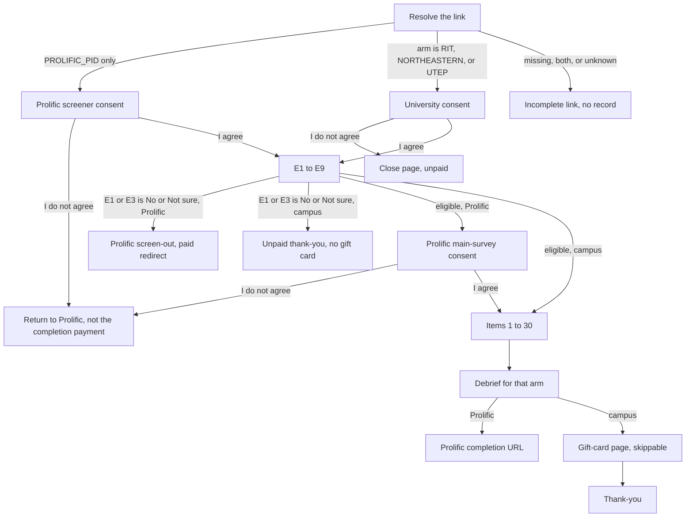

# Agent-addon decisions

Pilot survey for *Understanding User Mental Models and Decision-Making When Using Third-Party Capabilities for AI-Agent Systems* (protocol IRB0000378).

Study id: `agent-addon-decisions`. Config: `public/agent-addon-decisions/config.json`. Version is `pilot`.

Contact: Saniat Javid Sohrawardi, john.sohrawardi@rit.edu.

## Entry links

| Who | URL |
|---|---|
| Prolific | `/agent-addon-decisions?PROLIFIC_PID=...&STUDY_ID=...&SESSION_ID=...` |
| RIT | `/agent-addon-decisions?arm=RIT` |
| Northeastern | `/agent-addon-decisions?arm=NORTHEASTERN` |
| UTEP | `/agent-addon-decisions?arm=UTEP` |

`arm` is matched without regard to case. A visit to `/?arm=RIT` (or the other two campus codes) forwards to this study and keeps the query string. A Prolific id on `/` does not.

A link with no arm and no Prolific id, an unrecognized `arm`, or both a Prolific id and an `arm` shows an incomplete-link page and does not create a participant record. Put the campus code in the real link. A redirect that drops `arm` will not pay the student, because the Prolific path has no gift-card page.

`recruitment_arm` is stored on every record that is created, including screen-outs. It is `PROLIFIC`, `RIT`, `NORTHEASTERN`, or `UTEP`.

## Flow

Screened-out people do not see the debrief or the gift-card page. They never saw the listings, so there is nothing held back to explain.

## What each arm answers

Items 1–30 are the same words, in the same order, for every arm. Do not reorder them. Consent, E1–E9, item 6, and the interview yes/no are required. Item 6 is required because it chooses the reasons list. The other survey questions can be left blank. The gift-card name and university email are required only if the participant chooses to submit that page; the page itself can still be skipped. Questions that do not decide the next page share a page: E2 with E3, E4 through E9, items 1–2, 4–5, 6–8, 13–14, 15–16, and 20–21. A question stays on its own page when the answer decides whether the next page appears. Questions, consent text, and the InboxLane card are capped at 42rem and centered. DocPolish and DocPolish Plus sit side by side when the window is at least 700px wide, and stack below that. Nothing before the listings names security, privacy, or risk. Item 10 (what they did before deciding) has to stay ahead of item 11 (what mattered). Items 15 and 16 (open questions about access) have to stay ahead of the access checklist. Item 27 is the only item that names security, and it stays after the listings.

Prolific answers E1–E9 after the screener consent and before the main-survey consent. Campus participants have no separate screener, so the same nine items run inline after the university consent, before item 1. They are numbered E1–E9 in both arms so items 1–30 keep their numbers.

E3 is one question: Yes, No, or Not sure. The stem lists the six third-party actions. No and Not sure end the survey, same as E1. The record does not say which of the six actions they did. Item 1 still asks which kinds of add-ons they use.

A few later items are split so a single answer can branch:

- Item 3 shows the sentence they typed at E6 and asks whether to talk about that add-on. "Yes, let us use that one" skips items 4 and 5.
- Item 10 asks whether they did any research or checks before deciding. The checklist appears only on Yes.
- Item 11 is one of two lists. The decline list is shown when item 6 is "used it, and later turned it off or removed it," "turned it off or removed it without really using it," or "decided not to use it." Everyone else sees the keep list. Up to three selections.
- Item 17 asks whether any current add-on can reach things outside the chat. The inventory appears only on Yes.
- Items 12, 18, and 19 ask for a short follow-up only on Yes.
- Item 28 skips the contact question on No.

## Listings

Section 5 is two made-up listings. Nothing on them installs, links out, or names a real product.

- Listing 1 is one InboxLane card, either the detailed "What it asks for" block or the single broad line. Each person sees one. Which one is assigned by a latin square in arrival order across the whole study, not in a separate queue per arm.
- Listing 2 shows DocPolish and DocPolish Plus together. Which card is first is assigned the same way.

## Payment and exits

| Exit | Prolific | Campus |
|---|---|---|
| Does not qualify at E1 or E3 | Screen-out redirect, $0.55 | Unpaid thank-you. No gift card |
| Declines consent | Return redirect, not the completion payment | Close page, unpaid |
| Finishes | Completion redirect, $8.00 | Debrief, then the gift-card page, then thank-you |

The three Prolific URLs are on `p-complete`, `p-screenout`, and `p-return` in the config. The codes are placeholders until the live Prolific study exists:

- `cc=REPLACE_COMPLETION`
- `cc=REPLACE_SCREENOUT`
- `cc=REPLACE_RETURN`

Replace those three strings in `config.json` before launch. The same constants are also in `src/public/agent-addon-decisions/assets/prolificUrls.ts`.

## Gift card records

Campus completers can enter a full name and a university email address. They can skip the page. Skipping stores nothing identifying, and their answers are kept.

Those two fields are the only ones in this study's identifier collection. That matches the protocol: the card needs a name and a university email. Campus is already known from `recruitment_arm`. No university ID is collected.

The records are not fields on the survey answer document and are not in the survey export. In analysis, the **Identifier info** tab appears only for a study that defines `identifierCollection`. It can export JSON or CSV of these records alone. Each row shows the date the record should be deleted (30 days after it was saved). **Delete due records** removes only rows whose date has passed. It does not run on its own. Someone has to open the tab and press it. The protocol also says not later than 90 days, so do not leave due rows sitting there.

The interview contact (item 29) is not part of this collection. It is a survey answer, shown only if item 28 is Yes.

## Consent

- Prolific sees two consents: the screener, then the main survey after they qualify. Each has an optional UK/EEA/Switzerland checkbox. It is not required for people outside those places.
- Campus sees one consent, covering eligibility and the survey. It has no GDPR section. It says an ineligible path is unpaid, and that the gift-card page can be skipped.
- Interview consents are not in this survey. Item 28 only records willingness.

## Before Wave 1

- Paste the three live Prolific completion codes.
- Confirm a campus short link keeps `arm` on the URL.
- Open a bad link and confirm no participant row appears.
- On a campus test account, fail E1 and confirm there is no gift-card page. Finish another account, skip the gift card, then finish one more and confirm the name and email show only on Identifier info.
- Do not move items 1–30. The comparison the study is built around is item 10, then the listings, then item 27.
